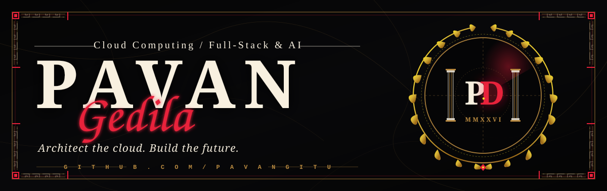
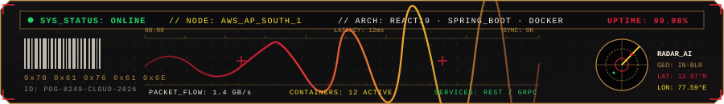
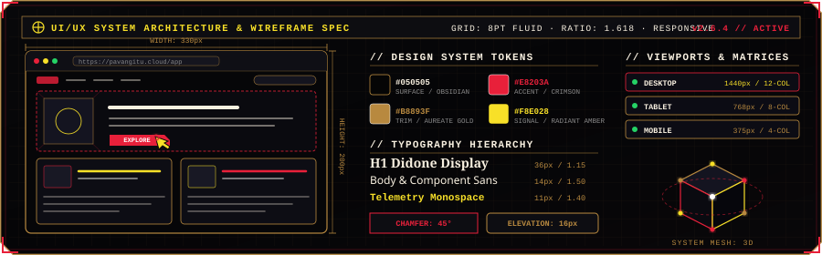
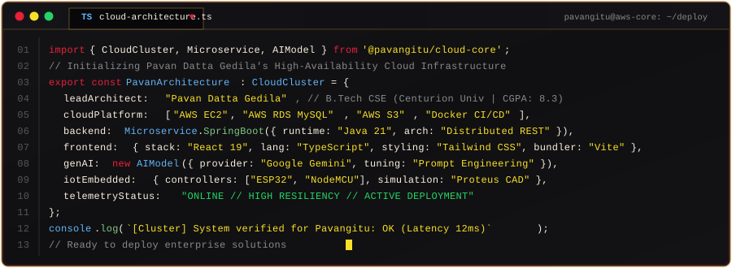
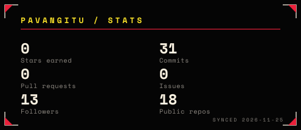
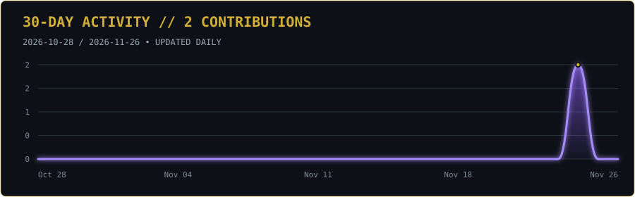
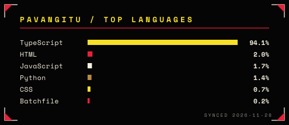

<div align="center">



<br><br>

<p align="center">
  <a href="https://github.com/Pavangitu?tab=followers"></a>
  &nbsp;
  
  &nbsp;
  <a href="https://linkedin.com/in/pavan-datta-gedila-7a1089369"></a>
</p>

<p align="center">
  
</p>

<br>

<p align="center">
  
</p>

<p align="center">
  <a href="https://linkedin.com/in/pavan-datta-gedila-7a1089369"></a>
  <a href="mailto:pavandattagedila@gmail.com"></a>
  <a href="https://wa.me/918249397556"></a>
  <a href="https://x.com/DattaGedila"></a>
</p>

</div>

<br>

<div align="center">
  
</div>

<br>

<h2 align="center"></h2>

```
  ____   _  __     ___    _   _   ____    _  _____ _____  _    
 |  _ \ / \ \ \   / / \  | \ | | |  _ \  / \|_   _|_   _|/ \   
 | |_) / _ \ \ \ / / _ \ |  \| | | | | |/ _ \ | |   | | / _ \  
 |  __/ ___ \ \ V / ___ \| |\  | | |_| / ___ \| |   | |/ ___ \ 
 |_| /_/   \_\ \_/_/   \_\_| \_| |____/_/   \_\_|   |_/_/   \_\
```

👋 **Hello! I'm Pavan Datta Gedila** — a passionate **Cloud & Full-Stack Software Engineer, AI Developer, and IoT Specialist** pursuing a Bachelor of Technology in Computer Science & Engineering at **Centurion University of Technology and Management, Odisha** (2023 – 2027 | **CGPA: 8.3 / 10**).

> **🎯 Career Objective:**  
> *"To start my professional journey in cloud technology with a progressive organization that values innovation and learning. I aspire to apply my knowledge of cloud architecture, virtualization, and networking to real-world applications."*

---

### 🌟 Professional Experience & Internships

- 🏢 **Cloud Computing & Full Stack Intern @ Samriddhi Anveshana Pvt. Ltd.** *(2026 – Present | Bengaluru, Karnataka)*
  - Leading the end-to-end architecture and implementation of an enterprise **Office Management System**.
  - Developed scalable, interactive frontends using **React 19**, **TypeScript**, and **Tailwind CSS** with responsive mobile-first layouts.
  - Engineered robust backend microservices in **Spring Boot (Java)** and **Node.js/Express**, containerized using **Docker**, and deployed across **AWS (EC2, S3, RDS MySQL)**.
  - Implemented secure API authentication, database connection pooling, and continuous deployment automation.

- ☁️ **Cloud Computing Intern @ Micro Information Technology Services** *(2024)*
  - Implemented and evaluated foundational cloud service models (**IaaS**, **PaaS**, **SaaS**) and deployment patterns.
  - Gained hands-on expertise in **AWS** services including **EC2**, **VPC**, **IAM**, Subnets, Security Groups, and **S3** storage policies.
  - Managed virtualization environments, resource allocation, and cloud access security while reducing simulated infrastructure costs.

---

### 🏆 Key Achievements & Milestones

- 🏅 **Technical Events & Hackathons:** Actively participated in university technical symposiums, coding competitions, and hands-on cloud architecture workshops.
- 🚀 **Cloud Infrastructure Deployments:** Successfully designed, containerized, and deployed multiple scalable mini and enterprise-grade full-stack systems on AWS EC2 & RDS.
- 🔌 **Open-Source Hardware Simulation Contribution:** Developed and published an open-source **Flame Sensor Library for Proteus CAD**, widely adopted by hardware engineers and IoT researchers for optical circuit simulation.
- 💻 **Competitive Problem Solving:** Earned certified HackerRank credentials in **Problem Solving** (Basic & Intermediate) and **SQL** (Basic & Intermediate).

---

### 👤 Personal Details & Background

| Attribute | Details |
| :--- | :--- |
| **Full Name** | Pavan Datta Gedila |
| **Date of Birth** | 16 / 06 / 2005 |
| **Primary Location** | Bengaluru, Karnataka / Odisha, India |
| **Languages Spoken** | **Telugu** (Native/Full Professional) · **English** (Professional) · **Hindi** (Professional) · **Odia** (Professional Working) |
| **Hobbies & Interests** | Exploring New Technologies · Algorithmic Problem Solving · Cloud Architecture · Hardware IoT Hacking |

---

<h2 align="center" id="tech-stack--skills"></h2>

<div align="center">

<h3>Programming Languages</h3>

<p align="center">


</p>

<h3>Cloud, DevOps &amp; Infrastructure</h3>

<p align="center">


</p>

<h3>Web &amp; Backend Frameworks</h3>

<p align="center">


</p>

<h3>Operating Systems, Systems &amp; Networking</h3>

<p align="center">


</p>

<h3>Databases &amp; Caching</h3>

<p align="center">


</p>

<h3>Artificial Intelligence &amp; Computer Vision</h3>

<p align="center">


</p>

<h3>Hardware, IoT &amp; Embedded Systems</h3>

<p align="center">


</p>

<h3>Developer Tools &amp; Environment</h3>

<p align="center">


</p>

</div>

---

<div align="center">
  
</div>

<br>

<div align="center">
  
</div>

<br>

<h2 align="center">🚀 Featured Engineering Projects Showcase</h2>

<table width="100%">
  <tr>
    <td width="50%" valign="top">
      <h3 align="left">📄 <a href="https://github.com/Pavangitu/career-with-resume.git">CareerWith – AI Resume Builder</a></h3>
      <p><b>Stack:</b> React 19 · TypeScript · Tailwind CSS · Google Gemini AI · Vite</p>
      <p>An intelligent, production-grade resume architect featuring 15 custom glassmorphic layout templates. Incorporates dynamic real-time ATS scoring, LLM-powered feedback critique with Gemini AI, live typography rendering, and crisp single-page A4 PDF generation.</p>
      <p>
        <a href="https://github.com/Pavangitu/career-with-resume.git">
          
        </a>
      </p>
    </td>
    <td width="50%" valign="top">
      <h3 align="left">☁️ <a href="https://github.com/Pavangitu/calc.git">AWS Dockerized Node.js Application</a></h3>
      <p><b>Stack:</b> AWS EC2 · Docker · Node.js · Express · GitHub Actions CI/CD</p>
      <p>High-availability containerized microservice architected and deployed on AWS EC2 with continuous automated integration. Utilizes secured VPC subnets, IAM role policies, and streamlined container lifecycle management to slash deployment overhead by 80%.</p>
      <p>
        <a href="https://github.com/Pavangitu/calc.git">
          
        </a>
      </p>
    </td>
  </tr>
  <tr>
    <td width="50%" valign="top">
      <h3 align="left">💼 <a href="https://github.com/Pavangitu/pavan-datta-_-portfolio.git">Interactive Developer Portfolio Suite</a></h3>
      <p><b>Stack:</b> React 19 · TypeScript · Vite · Tailwind CSS · Express · EmailJS</p>
      <p>Modern developer portfolio web platform engineered with sleek responsive layout, interactive project showcases, live modal previews, direct contact integration via EmailJS, and full Express backend API support.</p>
      <p>
        <a href="https://github.com/Pavangitu/pavan-datta-_-portfolio.git">
          
        </a>
      </p>
    </td>
    <td width="50%" valign="top">
      <h3 align="left">🏢 <a href="https://github.com/aws7556-cloud/Workfella-test.git">Workafella Coworking Booking Platform</a></h3>
      <p><b>Stack:</b> React · TypeScript · Spring Boot (Java) · MySQL · AWS Cloud</p>
      <p>Comprehensive enterprise desk and workspace reservation platform. Built with normalized relational database models, dynamic real-time floor availability indicators, transactional booking locks, and zero booking collisions.</p>
      <p>
        <a href="https://github.com/aws7556-cloud/Workfella-test.git">
          
        </a>
      </p>
    </td>
  </tr>
  <tr>
    <td width="50%" valign="top">
      <h3 align="left">🎮 <a href="https://github.com/Pavangitu/Desktop-pet.git">Gear 5 Luffy – Desktop Pet Companion</a></h3>
      <p><b>Stack:</b> Python · PySide6 · PyWin32 · OS Window Physics</p>
      <p>An interactive animated desktop companion engineered with custom transparent window rendering, 60 FPS animation loops, physics collision detection against active OS application windows, and interactive event triggers.</p>
      <p>
        <a href="https://github.com/Pavangitu/Desktop-pet.git">
          
        </a>
      </p>
    </td>
    <td width="50%" valign="top">
      <h3 align="left">🌡️ <a href="https://github.com/Pavangitu/Environment_Monitoring_System.git">Environment Monitoring System</a></h3>
      <p><b>Stack:</b> ESP32 · NodeMCU · C++ · MQ Sensors · Proteus VSM</p>
      <p>Real-time telemetric environment monitoring system engineered for industrial safety. Senses ambient temperature, humidity, toxic gases, and infrared flame hazards with sub-second threshold alarms and remote web telemetry.</p>
      <p>
        <a href="https://github.com/Pavangitu/Environment_Monitoring_System.git">
          
        </a>
      </p>
    </td>
  </tr>
  <tr>
    <td width="50%" valign="top">
      <h3 align="left">🔥 <a href="https://github.com/Pavangitu/Flame-Sensor-Library-For-Proteus.git">Proteus Flame Sensor CAD Library</a></h3>
      <p><b>Stack:</b> C++ · Proteus CAD · Schematic Modeling · Circuit Simulation</p>
      <p>Published open-source simulation component for Proteus Design Suite mimicking real-world 3-pin and 4-pin infrared flame detector modules. Enables engineers to safely simulate optical fire detection without physical hardware.</p>
      <p>
        <a href="https://github.com/Pavangitu/Flame-Sensor-Library-For-Proteus.git">
          
        </a>
      </p>
    </td>
    <td width="50%" valign="top">
      <h3 align="left">🧮 <a href="https://github.com/Pavangitu/scientificcalculator.git">Creative Hybrid Calculator Suite</a></h3>
      <p><b>Stack:</b> React · TypeScript · Java Swing · Financial Engines</p>
      <p>Versatile computation suite supporting Standard, Scientific, Programmer (Binary/Octal/Hexadecimal bitwise operations), and Financial loan amortization modes with instant Microsoft Excel / CSV statement export.</p>
      <p>
        <a href="https://github.com/Pavangitu/scientificcalculator.git">
          
        </a>
      </p>
    </td>
  </tr>
  <tr>
    <td width="50%" valign="top">
      <h3 align="left">⏰ Alarm Clock Web Application</h3>
      <p><b>Stack:</b> JavaScript · HTML5 · CSS3 · JSON · LocalStorage API</p>
      <p>A sleek, lightweight web utility designed for time management. Features multi-alarm configurations, custom audio tones, snooze intervals, and persistent state management using browser LocalStorage and structured JSON schemas.</p>
      <p>
        
      </p>
    </td>
    <td width="50%" valign="top">
      <h3 align="left">📑 OCR Automated Document Conversion System</h3>
      <p><b>Stack:</b> Python · Tesseract OCR · OpenCV · Flask · PyMuPDF</p>
      <p>Automated optical character recognition pipeline converting scanned multi-lingual documents, receipts, and invoices into structured, searchable text formats with intelligent tabular detection, slashing manual data entry by 70%.</p>
      <p>
        
      </p>
    </td>
  </tr>
</table>

---

<h2 align="center">📜 Industry Certifications &amp; Accreditations</h2>

<div align="center">

| Certificate Title | Issuing Organization | Domain | Status |
| :--- | :--- | :--- | :--- |
| **AWS Cloud Practitioner Essentials** | Amazon Web Services (AWS) | Cloud Architecture &amp; Foundations | 🟡 *In Progress* |
| **Responsible AI Basics** | Google | Generative AI &amp; Ethics | 🟢 *Certified* |
| **Introduction to Generative AI Studio** | Google | GenAI &amp; Model Orchestration | 🟢 *Certified* |
| **Machine Learning Basics** | Amazon Web Services (AWS) | Cloud Machine Learning | 🟢 *Certified* |
| **Master Data Management for Beginners** | Tata Consultancy Services (TCS) | Data Governance &amp; Architecture | 🟢 *Certified* |
| **Prompt Engineering Specialization** | SkillUP / Simplilearn | LLM Tuning &amp; Prompt Engineering | 🟢 *Certified* |
| **Technology Risk Job Simulation** | Ernst &amp; Young (EY) | Cybersecurity &amp; Risk Audit | 🟢 *Certified* |
| **Introduction to Cybersecurity Simulation** | Commonwealth Bank | Security Architecture &amp; Defense | 🟢 *Certified* |
| **AI &amp; Machine Learning Foundations** | IBM | Artificial Intelligence &amp; Neural Nets | 🟢 *Certified* |
| **AI &amp; Content Strategy Specialization** | Semrush | AI Content Modeling | 🟢 *Certified* |
| **Introduction to Cybersecurity** | Cisco | Network &amp; Systems Security | 🟢 *Certified* |
| **Problem Solving (Basic &amp; Intermediate)** | HackerRank | Algorithms &amp; Data Structures | 🟢 *Certified* |
| **SQL (Basic &amp; Intermediate)** | HackerRank | Database Query Optimization | 🟢 *Certified* |
| **Learn AutoCAD 2D &amp; 3D: Zero to Hero** | Autodesk | 2D/3D Schematic CAD Design | 🟢 *Certified* |
| **Mastering Network Security: Defending Against Cyber Threats** | Network Credentials Core | Threat Hunting &amp; Firewalls | 🟢 *Certified* |
| **AI for Students - Build Your Own Generative AI Model** | AI Academic Core | Machine Learning Architecture | 🟢 *Certified* |
| **Responsive Web Design Certification** | freeCodeCamp | Modern Frontend Standards | 🟢 *Certified* |

</div>

---

<h2 align="center" id="github-stats"></h2>

<div align="center">




<br><br>

<h3>Monthly Contribution Wave</h3>



</div>

---

<h2 align="center" id="top-languages"></h2>

<div align="center">



</div>

---

<div align="center">

<a href="https://github.com/Pavangitu">
  
</a>

<br><br>

<h3>Pacman Contribution Animation</h3>



</div>

<br><br>

<h2 align="center" id="lets-connect"></h2>

<div align="center">
  
</div>

<br>

<p align="center"><b>Ready to build resilient cloud architectures, scalable software, and intelligent AI systems together? Let's connect!</b></p>

<p align="center">
  <a href="https://linkedin.com/in/pavan-datta-gedila-7a1089369"></a>
  <a href="mailto:pavandattagedila@gmail.com"></a>
  <a href="https://github.com/Pavangitu"></a>
  <a href="https://x.com/DattaGedila"></a>
  <a href="https://www.instagram.com/she__call_me_single"></a>
  <a href="https://wa.me/918249397556"></a>
</p>

<br>

<div align="center">
  <a href="https://linkedin.com/in/pavan-datta-gedila-7a1089369">
    
  </a>
  &nbsp;&nbsp;
  <a href="https://wa.me/918249397556">
    
  </a>
  &nbsp;&nbsp;
  <a href="mailto:pavandattagedila@gmail.com">
    
  </a>
</div>

<br>

<p align="center">
  📞 <b>Direct Phone:</b> <code>+91 8249397556</code> &nbsp;|&nbsp; 
  📍 <b>Base:</b> <code>Bengaluru / Odisha, India</code> &nbsp;|&nbsp; 
  ⚡ <b>Available for:</b> Cloud Engineering, Full-Stack Development &amp; AI Solutions
</p>

<br>


